# Dashboard V3 Backend Integration Implementation Spec

> **Document Path**: `docs/DashboardV3BackendIntegrationImplementationSpec.md`
>
> **Status**: Draft — Ready for Repo Path Verification
>
> **Reference Documents**: `docs/DashboardSummaryApiContract.md` (v1.0), `docs/DashboardV3BackendIntegrationPlan.md` (V2.2), `docs/NullableContractAudit.md`

---

## 1. Integration Overview

### Current State
Frontend Dashboard V3 已完成 UX Blueprint、元件骨架、ViewModel 與 `IDashboardDataSource` 抽象邊界，但正式入口（`AuthApp`）尚未切換至 `ApiDashboardDataSource`，且 `dashboardV3ApiMapper` 仍依賴 `mockDashboardData` 作為缺失欄位的 fallback。Backend 已完成 Summary API（`GET /api/dashboard/summary`）並啟用 Swagger Nullable Reference Type 支援。

### Target State
Dashboard V3 全面切換為 **API-only** 資料流，徹底移除生產環境對 `mockDashboardData` 的依賴。所有已具備 Backend Contract 的區塊（總資產、帳戶清單、最近交易紀錄、業務基準日）皆由真實 API 驅動；尚未具備 Backend Contract 的區塊（預算、目標、月曆、今日支出）改以明確的 `Pending / Empty` 狀態呈現，嚴禁真假資料混合。

### Migration Strategy
1. **Before**:
   ```text
   DashboardV3
   ↓
   Mock Data (MockDashboardDataSource / dashboardV3ApiMapper fallback)
   ```
2. **After**:
   ```text
   DashboardV3
   ↓
   API Client (ApiDashboardDataSource + dashboardV3ApiMapper)
   ↓
   Dashboard API (GET /api/dashboard/summary)
   ↓
   Database (Account, Transaction)
   ```

---

## 2. Existing Backend Contract

### Endpoint

| Endpoint | Method | Purpose | Status |
| :--- | :---: | :--- | :---: |
| `/api/dashboard/summary` | `GET` | 提供 Dashboard V3 Summary（總資產、業務日期、帳戶列表、最近交易紀錄） | Existing |

### Response DTO

| DTO | Field | Source | Nullable |
| :--- | :--- | :--- | :---: |
| `DashboardSummaryDto` | `totalAssets` | `Account` (`!IsDeleted && !IsSystemAccount` 餘額加總) | No |
| `DashboardSummaryDto` | `businessDate` | Backend 業務基準日期 (`string`) | No |
| `DashboardSummaryDto` | `accounts` | `Account` 活躍帳戶投影 (`DashboardAccountDto[]`) | No |
| `DashboardSummaryDto` | `recentTransactions` | `Transaction` 最新交易投影 (`RecentTransactionDto[]`) | No |
| `DashboardAccountDto` | `id` | `Account.Id` (`Guid`) | No |
| `DashboardAccountDto` | `name` | `Account.Name` (`string`) | No |
| `DashboardAccountDto` | `balance` | `Account.CurrentBalance` (`decimal`) | No |
| `DashboardAccountDto` | `type` | Legacy Enum 數字值 (`number` — 新功能禁用) | No |
| `DashboardAccountDto` | `accountType` | Canonical String (`Cashflow` / `Saving` / `Invest`) | No |
| `RecentTransactionDto` | `id` | `Transaction.Id` (`Guid`) | No |
| `RecentTransactionDto` | `amount` | `Transaction.Amount` (`decimal`) | No |
| `RecentTransactionDto` | `note` | `Transaction.Note` (`string`) | **Yes** |
| `RecentTransactionDto` | `type` | Legacy Enum 數字值 (`number` — 新功能禁用) | No |
| `RecentTransactionDto` | `transactionType` | Canonical String (`Expense` / `Income` / `Transfer`) | No |
| `RecentTransactionDto` | `date` | `Transaction.TransactionDate` (`string`) | No |

---

## 3. Frontend Replacement Plan

將現有 Mock 依賴收斂至標準資料流：`Mock → API Hook (useDashboardData) → Mapper (dashboardV3ApiMapper) → Component`。

| Frontend File (`LifeDashboard.Web/src/...`) | Current | Replace With |
| :--- | :--- | :--- |
| `AuthApp` *(TBD: Verify exact path)* | 注入 `MockDashboardDataSource` | 注入 `ApiDashboardDataSource`（或透過環境變數 Factory 預設回傳 API） |
| `dashboardV3ApiMapper.ts` *(TBD: Verify path)* | 依賴 `mockDashboardData` 作為缺失欄位 fallback | 純函數 Mapper：對齊 `DashboardSummaryDto`、`accountType` / `transactionType` 防禦映射、未實作區塊輸出 `Pending` |
| `ApiDashboardDataSource.ts` *(TBD: Verify path)* | 基礎 API 呼叫骨架 | 呼叫 `GET /api/dashboard/summary`，補齊 `AbortSignal` 與標準化 `ApiError` |
| `useDashboardData.ts` *(TBD: Verify path)* | 未完整處理 Cancel / Retry / Error | 補齊 `AbortController`（Unmount 自動取消）、`isLoading`、`error`、`retry()` |
| `dashboardV3SummaryStore.ts` *(TBD: Verify path)* | 閒置 Zustand Store | 確認零引用後**直接刪除** |
| `DashboardV3Page` & Widgets *(TBD: Verify paths)* | 假設 Mock 資料永遠存在 | 補齊 Loading Skeleton、Empty State、Pending State、Error + Retry 與 Privacy Masking |
| `mockDashboardData.ts` *(TBD: Verify path)* | 被正式環境 Mapper 引用 | 僅保留於測試 / 開發工具，從正式資料流中徹底移除 |

---

## 4. Data Mapping Specification

### Dashboard Summary（Hero）

| Backend Field | Frontend Field | Notes |
| :--- | :--- | :--- |
| `totalAssets` | `heroStats.totalAssets` | 套用 Currency + Privacy Formatter（強制遮罩） |
| `businessDate` | `meta.businessDate` | 套用安全 `DateOnly` Formatter（禁止 `new Date("YYYY-MM-DD")`） |

### Account Cards（Account Summary）

| Backend Field | Frontend Field | Notes |
| :--- | :--- | :--- |
| `totalAssets` | `accountSummary.totalBalance` | 直接複用，禁止前端重新加總 `accounts[]` |
| `accounts[].id` | `accountSummary.items[].id` | React Key |
| `accounts[].name` | `accountSummary.items[].name` | 使用者自訂名稱，不翻譯 |
| `accounts[].balance` | `accountSummary.items[].balance` | 套用 Currency + Privacy Formatter（強制遮罩） |
| `accounts[].accountType` | `accountSummary.items[].type` | 消費 `accountType`（`Cashflow` / `Saving` / `Invest` / `Unknown`），忽略 legacy `type` |

### Recent Transactions

| Backend Field | Frontend Field | Notes |
| :--- | :--- | :--- |
| `recentTransactions[].id` | `recentTransactions.items[].id` | React Key |
| `recentTransactions[].amount` | `recentTransactions.items[].amount` | 依 `transactionType` 決定正負號與色票 |
| `recentTransactions[].note` | `recentTransactions.items[].title` | `note ?? ""`；若為空字串，退回 `transactionType` 預設翻譯標籤 |
| `recentTransactions[].transactionType` | `recentTransactions.items[].type` | 消費 `transactionType`（`Expense` / `Income` / `Transfer` / `Unknown`），忽略 legacy `type` |
| `recentTransactions[].date` | `recentTransactions.items[].date` | 套用安全 `DateOnly` Formatter |
| `Missing Contract` | `recentTransactions.items[].categoryName` | Backend Contract Gap（目前未提供，UI 暫時隱藏） |
| `Missing Contract` | `recentTransactions.items[].accountName` | Backend Contract Gap（目前未提供，UI 暫時隱藏） |

### Expense Summary

| Backend Field | Frontend Field | Notes |
| :--- | :--- | :--- |
| `Missing Contract` | `heroStats.spentToday` | Backend Contract Gap（`DashboardSummaryApiContract.md` v1.0 未包含 `todayExpense`，禁止前端自行加總 `recentTransactions`） |

### Budget Information

| Backend Field | Frontend Field | Notes |
| :--- | :--- | :--- |
| `Missing Contract` | `heroStats.remainingBudget` | Backend Contract Gap（UI 顯示 `—` / Pending） |
| `Missing Contract` | `budgetRadar` | Backend Contract Gap（UI 顯示 Pending State） |

### Goals

| Backend Field | Frontend Field | Notes |
| :--- | :--- | :--- |
| `Missing Contract` | `goalProgress` | Backend Contract Gap（UI 顯示 Pending State） |

---

## 5. Missing Backend Contract

### Blocking（沒有此資料無法完整呈現既有 UI 設計）
* **`todayExpense`（Hero Expense Summary）**：`DashboardSummaryApiContract.md` v1.0 未提供此欄位。因前端嚴禁由最多 5 筆的 `recentTransactions` 自行計算當日支出，若產品要求 Hero 必須顯示今日支出，此項為 Blocking；若允許先降級顯示 `—`（Pending），則可轉為 Non-blocking。

### Non-blocking（可先透過安全 Fallback 或 Pending State 上線）
* **`RecentTransactionDto.categoryName` & `accountName`**：前端可先以 `note`（空值時退回 `transactionType` 標籤）+ `date` + `amount` 呈現精簡版交易列表。
* **`Budget Radar` & `remainingBudget`**：前端以 `Pending` 狀態卡片呈現，不阻塞 Summary API-only 切換。
* **`Goal Progress`**：前端以 `Pending` 狀態卡片呈現，不阻塞 Summary API-only 切換。
* **`Calendar`（Monthly & Day Detail）**：前端以 `Pending` 狀態卡片呈現，待獨立 Calendar Contract 完成後接入。

### Future Enhancement（後續 Sprint）
* **Fixed Commitment Contract**：固定支出清單與到期日提醒。
* **Spending Trend / Multi-Currency / User Timezone `businessDate`**。

---

## 6. API Integration Flow

```mermaid
flowchart LR
    DashboardV3["DashboardV3Page + Widgets"]
    --> Hook["useDashboardData (AbortController / State)"]
    --> APIClient["ApiDashboardDataSource + dashboardV3ApiMapper"]
    --> Controller["DashboardController (GET /api/dashboard/summary)"]
    --> Handler["GetDashboardSummaryQueryHandler"]
    --> Reader["DashboardSummaryReader (AsNoTracking Projection)"]
    --> Database["SQL Server (Account, Transaction)"]
```



---

## 7. Error Handling Specification

| 情境 | 觸發條件 | Frontend 行為 |
| :--- | :--- | :--- |
| **API Failure** | HTTP `500` / 非預期錯誤 | 轉譯為標準化 `ApiError`（`isRetryable: true`），顯示友善 Error Banner 與 `Retry` 按鈕，不白屏、不退回 Mock。 |
| **Empty Data** | `200 OK` 且 `accounts: []` 或 `recentTransactions: []` | 視為正常新用戶狀態，`totalAssets` 顯示 `0`，列表區塊顯示對應 Empty State 引導文案。 |
| **Unauthorized** | HTTP `401 Unauthorized` | 轉譯為 `ApiError`（`isRetryable: false`），交由既有全域 Auth 機制清除憑證並導向登入頁。 |
| **Validation Error** | HTTP `400 Bad Request` | 轉譯為 `ApiError`（`isRetryable: false`），記錄錯誤並顯示系統異常提示。 |
| **Network Timeout / Offline** | 網路中斷或請求超時 | 顯示網路連線異常提示並提供 `Retry` 按鈕；元件 Unmount 時透過 `AbortController` 取消請求並靜默忽略 `AbortError`。 |

---

## 8. Implementation Order

* **Phase 1：API Client & DTO Mapping**
  * 核對本機實際檔案路徑與 `RecentTransactionDto.Note` Nullable 實碼。
  * 建立/更新前端 DTO 型別對齊 `DashboardSummaryApiContract.md` v1.0（含 `accountType`：`Cashflow`/`Saving`/`Invest` 與 `transactionType`：`Expense`/`Income`/`Transfer`）。
  * 重構 `dashboardV3ApiMapper` 為純函數，補齊安全 `DateOnly` Formatter。
* **Phase 2：Replace Mock Data**
  * 更新 `DashboardViewModel`（支援 `Pending` 與 `Empty` 狀態，清理非核心欄位）。
  * 更新 `HeroStats`、`AccountSummaryWidget`、`RecentTransactionsWidget` 串接真實映射資料，其餘未實作 Widget 呈現 `Pending` 狀態。
* **Phase 3：Loading / Error State**
  * 強化 `IDashboardDataSource`、`ApiDashboardDataSource` 與 `useDashboardData`（`AbortController`、`ApiError`、`Retry`、Loading Skeleton）。
  * 補齊五語系（`zh-TW`, `en`, `pt-BR`, `ko`, `ja`）之 `AccountType`、`Pending`、`Empty`、`Error`、`Retry` 翻譯鍵值。
* **Phase 4：Remove Mock Dependency**
  * 刪除未使用的 `dashboardV3SummaryStore`。
  * 於 `AuthApp` 正式將 `dataSource` 切換至 `ApiDashboardDataSource`，確認生產環境零 `mockDashboardData` 引用。

---

## 9. Copilot Implementation Checklist

> **執行前提**：Copilot 動工前須先掃描本機確認下方 `TBD` 路徑，禁止修改任何 Backend Domain Entity、Migration 或未授權之 DTO。

* **Task 1：DTO 與 Enum 型別對齊**
  * **File**: `LifeDashboard.Web/src/.../dtos/dashboardSummaryDto.ts` *(TBD: Verify path)*
  * **Change**: 依 `DashboardSummaryApiContract.md` v1.0 定義 `DashboardSummaryDto`、`DashboardAccountDto`、`RecentTransactionDto`（`note: string | null`、`date: string`、`accountType`、`transactionType`）。
* **Task 2：Formatter 強化**
  * **File**: `LifeDashboard.Web/src/.../formatters/` *(TBD: Verify path)*
  * **Change**: 實作安全 `DateOnly` Formatter（字串拆解，禁用 `new Date("YYYY-MM-DD")`），並確認 Privacy Masking 與 Currency Formatter 整合。
* **Task 3：淨化 `dashboardV3ApiMapper`**
  * **File**: `LifeDashboard.Web/src/.../dashboardV3ApiMapper.ts` *(TBD: Verify path)*
  * **Change**: 移除所有 `mockDashboardData` import；實作 `accountType`（`Cashflow`/`Saving`/`Invest`/`Unknown`）與 `transactionType`（`Expense`/`Income`/`Transfer`/`Unknown`）防禦映射；處理 `note ?? ""` fallback；將缺失合約區塊映射為 `Pending`。
* **Task 4：強化 DataSource、Hook 與清理 Store**
  * **File**: `ApiDashboardDataSource.ts`, `useDashboardData.ts`, `dashboardV3SummaryStore.ts` *(TBD: Verify paths)*
  * **Change**: 補齊 `AbortSignal`、`ApiError`、`retry()`；確認 `dashboardV3SummaryStore` 零引用後刪除。
* **Task 5：更新 i18n 與 Dashboard Components，並切換 `AuthApp`**
  * **File**: 五語系 i18n JSON、`DashboardV3Page`、6 個 Widgets、`AuthApp` *(TBD: Verify paths)*
  * **Change**: 補齊翻譯鍵值與 Loading/Empty/Pending/Error 渲染防呆；於 `AuthApp` 切換為 `ApiDashboardDataSource`。

### Verification
* [ ] `dotnet build`（確認後端零錯誤）
* [ ] `npm run build`（確認 TypeScript 編譯與 Vite Production Build 零錯誤）
* [ ] API test（驗證 `GET /api/dashboard/summary` 回傳 `200 OK`、空狀態、`401` 與前端畫面正確渲染）