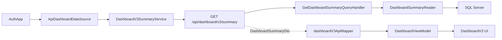

# Dashboard V3 Backend Integration Implementation Spec (v2)

> **Document Path**: `docs/DashboardV3BackendIntegrationImplementationSpec.md`
>
> **Version**: 2.0 (Contract Drift Resolved)
>
> **Status**: Active — Frontend Integration Source of Truth
>
> **Reference Documents**: `docs/DashboardSummaryApiContract.md`, `docs/DashboardV3UXDesignSpec.md`, `docs/NullableContractAudit.md`

---

## 1. Integration Overview

### Current State
依據 Step 0 程式碼核對結果，Frontend Dashboard V3 的正式資料流已串接至 V3 Summary API：

```text
AuthApp
↓
ApiDashboardDataSource
↓
DashboardV3SummaryService
↓
GET /api/dashboard/v3/summary
↓
DashboardV3 UI
```

目前 `MockDashboardDataSource` 僅保留於測試用途。本階段核心任務為消除 Contract Drift，確保前端 DTO、Mapper、型別定義與 Loading / Error 狀態完整對齊實際 V3 API 合約。

### Target State
* **Production**：完全零 Mock 依賴（No Mock Dependency），所有已支援欄位（含 `totalAssets`、`todayExpense`、`businessDate`、`accounts[]`、`recentTransactions[]`）皆 100% 由 `GET /api/dashboard/v3/summary` 驅動。
* **Test**：保留 `MockDashboardDataSource` 供單元測試與開發環境使用，與正式程式碼嚴格隔離。
* **Missing Domains**：尚未具備 Backend Contract 的區塊（Budget、Goal、Calendar、Fixed Commitment）維持明確的 `Pending / Empty` 狀態。

---

## 2. Existing Backend Contract

### Endpoint

| Endpoint | Method | Purpose | Status |
| :--- | :---: | :--- | :---: |
| `/api/dashboard/v3/summary` | `GET` | 提供 Dashboard V3 首屏核心摘要（總資產、今日支出、業務日期、帳戶列表、最近交易紀錄） | Existing |

### Response DTO（以 `DashboardSummaryApiContract.md` 為準）

| DTO | Field | Type | Nullable | Contract Status | Notes |
| :--- | :--- | :--- | :---: | :---: | :--- |
| `DashboardSummaryDto` | `totalAssets` | `decimal` | No | Existing | 所有非刪除且非系統帳戶餘額總和 |
| `DashboardSummaryDto` | `todayExpense` | `decimal` | No | **Existing** | `businessDate` 當日支出總額（已確認為既有合約欄位） |
| `DashboardSummaryDto` | `businessDate` | `string` | No | Existing | 業務基準日期（`YYYY-MM-DD`） |
| `DashboardSummaryDto` | `accounts` | `DashboardAccountDto[]` | No | Existing | 活躍帳戶清單（無資料為 `[]`） |
| `DashboardSummaryDto` | `recentTransactions` | `RecentTransactionDto[]` | No | Existing | 最新交易紀錄（無資料為 `[]`） |
| `DashboardAccountDto` | `id` | `Guid` | No | Existing | 帳戶識別碼 |
| `DashboardAccountDto` | `name` | `string` | No | Existing | 帳戶名稱（不翻譯） |
| `DashboardAccountDto` | `balance` | `decimal` | No | Existing | 帳戶餘額 |
| `DashboardAccountDto` | `type` | `number` | No | Legacy | 原 Enum 數字值（前端新功能禁用） |
| `DashboardAccountDto` | `accountType` | `string` | No | Canonical | `Cashflow` / `Saving` / `Invest` |
| `RecentTransactionDto` | `id` | `Guid` | No | Existing | 交易識別碼 |
| `RecentTransactionDto` | `amount` | `decimal` | No | Existing | 交易金額 |
| `RecentTransactionDto` | `note` | `string` | **Yes** | Updated | 備註（`string \| null`，前端須處理 `note ?? ""`） |
| `RecentTransactionDto` | `type` | `number` | No | Legacy | 原 Enum 數字值（前端新功能禁用） |
| `RecentTransactionDto` | `transactionType` | `string` | No | Canonical | `Expense` / `Income` / `Transfer` |
| `RecentTransactionDto` | `date` | `string` | No | Existing | 交易業務日期（`YYYY-MM-DD`） |

---

## 3. Frontend Replacement & Mock Boundary Plan

### Mock 邊界策略
* **Production**：**No Mock Dependency**。`AuthApp`、`ApiDashboardDataSource`、`DashboardV3SummaryService` 與 `dashboardV3ApiMapper` 嚴禁 import 或 fallback 至 `mockDashboardData`。
* **Test**：**`MockDashboardDataSource` retained**。保留供 Vitest 單元測試與元件開發使用，不刪除檔案。

### 前端對齊清單

| Frontend Component / Module | Current Status | Target Alignment |
| :--- | :--- | :--- |
| `AuthApp` | 已注入 `ApiDashboardDataSource` | 維持現狀，確認正式路徑零 Mock 引用 |
| `DashboardV3SummaryService` | 呼叫 `/api/dashboard/v3/summary` | 驗證 Endpoint 路徑、JWT Header、`AbortSignal` 與錯誤攔截 |
| Frontend DTO Types | 可能殘留舊欄位或未對齊 `DashboardSummaryApiContract.md` | 對齊 `todayExpense`、`accountType`、`transactionType`、`note: string \| null`、`date` |
| `dashboardV3ApiMapper` | 需確認完整映射與防禦邏輯 | 純函數映射：消費 canonical `accountType` / `transactionType`（含 `Unknown` fallback）、處理 `note ?? ""`、未實作區塊輸出 `Pending` |
| `useDashboardData` / `DashboardV3Page` | 需驗證完整非同步狀態 | 補齊 Loading Skeleton、Empty State、Error Banner、`Retry` 與 `AbortController` |
| `MockDashboardDataSource` | 測試用 Mock 實作 | **保留於測試用途**，確保不被 Production Bundle 引用 |

---

## 4. Data Mapping Specification

### Dashboard Summary（Hero & Expense Summary）

| Backend Field | Frontend Field | Notes |
| :--- | :--- | :--- |
| `totalAssets` | `heroStats.totalAssets` | 套用 Currency + Privacy Formatter（強制遮罩） |
| `todayExpense` | `heroStats.spentToday` | **Existing Contract Field**；套用 Currency + Privacy Formatter（強制遮罩） |
| `businessDate` | `meta.businessDate` | 套用安全 `DateOnly` Formatter（禁止 `new Date("YYYY-MM-DD")`） |

### Account Cards（Account Summary）

| Backend Field | Frontend Field | Notes |
| :--- | :--- | :--- |
| `totalAssets` | `accountSummary.totalBalance` | 直接複用，禁止前端重新加總 `accounts[]` |
| `accounts[].id` | `accountSummary.items[].id` | React Key |
| `accounts[].name` | `accountSummary.items[].name` | 使用者自訂名稱，不翻譯 |
| `accounts[].balance` | `accountSummary.items[].balance` | 套用 Currency + Privacy Formatter（強制遮罩） |
| `accounts[].accountType` | `accountSummary.items[].type` | 消費 `accountType`（`Cashflow` / `Saving` / `Invest` / `Unknown`），忽略 legacy `type` |

### Recent Transactions

| Backend Field | Frontend Field | Notes |
| :--- | :--- | :--- |
| `recentTransactions[].id` | `recentTransactions.items[].id` | React Key |
| `recentTransactions[].amount` | `recentTransactions.items[].amount` | 依 `transactionType` 決定正負號與色票 |
| `recentTransactions[].note` | `recentTransactions.items[].title` | `note?.trim()` 為空時退回 `transactionType` 預設翻譯標籤 |
| `recentTransactions[].transactionType` | `recentTransactions.items[].type` | 消費 `transactionType`（`Expense` / `Income` / `Transfer` / `Unknown`），忽略 legacy `type` |
| `recentTransactions[].date` | `recentTransactions.items[].date` | 套用安全 `DateOnly` Formatter |

### Unimplemented Domains（Budget / Goals / Calendar）

| Backend Field | Frontend Field | Notes |
| :--- | :--- | :--- |
| `Missing Contract` | `heroStats.remainingBudget` | 映射為 `null` / `Pending`（UI 顯示 `—`） |
| `Missing Contract` | `budgetRadar` | 映射為 `Pending` State |
| `Missing Contract` | `goalProgress` | 映射為 `Pending` State |
| `Missing Contract` | `calendar` | 映射為 `Pending` State |

---

## 5. Missing Backend Contract

### Blocking
* **無（None）**：`todayExpense` 已確認為 **Existing Contract Field**，目前無任何阻塞 Dashboard V3 Summary API-only 運作的後端缺口。

### Non-blocking（由前端以 Pending / Fallback 處理）
* `Budget Radar` & `remainingBudget`（Pending State）
* `Goal Progress`（Pending State）
* `Calendar`（Pending State，待獨立 Calendar Contract 接入）
* `RecentTransactionDto.categoryName` / `accountName`（若未提供，交易列表先以 `note` / `transactionType` + `date` + `amount` 呈現）

### Future Enhancement
* Fixed Commitment Contract
* Multi-Currency / User Timezone `businessDate`

---

## 6. API Integration Flow



---

## 7. Error Handling Specification

| 情境 | 觸發條件 | Frontend 行為 |
| :--- | :--- | :--- |
| **API Failure** | HTTP `500` / 非預期錯誤 | 轉譯為標準化 `ApiError`（`isRetryable: true`），顯示 Error Banner 與 `Retry` 按鈕，不退回 Mock。 |
| **Empty Data** | `200 OK` 且 `accounts: []` 或 `recentTransactions: []` | 視為正常空狀態，`totalAssets` / `todayExpense` 顯示 `0`，列表顯示 Empty State 引導。 |
| **Unauthorized** | HTTP `401 Unauthorized` | 轉譯為 `ApiError`（`isRetryable: false`），交由全域 Auth 機制導向登入頁。 |
| **Validation Error** | HTTP `400 Bad Request` | 轉譯為 `ApiError`（`isRetryable: false`），顯示錯誤提示。 |
| **Network Timeout / Abort** | 斷網、超時或元件 Unmount | 超時顯示可重試錯誤；Unmount 時透過 `AbortController` 取消請求並靜默忽略 `AbortError`。 |

---

## 8. Implementation Order（Frontend Only）

本階段**嚴格禁止修改 Backend**，依序完成以下 4 項收斂任務：

1. **Phase 1：API Endpoint Verification**
   * 驗證 `DashboardV3SummaryService` 與 `ApiDashboardDataSource` 確實指向 `GET /api/dashboard/v3/summary`，且無殘留 `/api/dashboard/summary` 呼叫。
2. **Phase 2：DTO Alignment**
   * 依 `DashboardSummaryApiContract.md` 對齊前端 DTO 型別（確認 `totalAssets`、`todayExpense`、`businessDate`、`accounts[].accountType`、`recentTransactions[].transactionType`、`note: string | null`、`date`）。
3. **Phase 3：Mapper Integration**
   * 確認 `dashboardV3ApiMapper` 零 `mockDashboardData` 依賴，完整映射 `todayExpense`、`accountType`（`Cashflow`/`Saving`/`Invest`/`Unknown`）、`transactionType`（`Expense`/`Income`/`Transfer`/`Unknown`）與 `note ?? ""`；未實作區塊輸出 `Pending`。
4. **Phase 4：Loading / Error State**
   * 補齊並驗證 `useDashboardData` 與 `DashboardV3Page` 的 Loading Skeleton、Empty State、Error Banner、`Retry` 與 `AbortController` 處理。

---

## 9. Copilot Implementation Checklist

> **嚴格限制**：**禁止修改任何 Backend 程式碼、DTO、Entity 或 Controller**；**保留 `MockDashboardDataSource` 供測試使用**。

* **Task 1：API Endpoint Verification**
  * **Scope**: `DashboardV3SummaryService`、`ApiDashboardDataSource`、`AuthApp`
  * **Change**: 確認正式請求端點為 `GET /api/dashboard/v3/summary`，確認正式路徑無 Mock 依賴，補齊 `AbortSignal` 透傳。
* **Task 2：DTO Alignment**
  * **Scope**: Frontend Dashboard Summary DTO 型別檔
  * **Change**: 對齊 `DashboardSummaryApiContract.md`，確保包含 `todayExpense`、`accountType`、`transactionType`、`note: string | null`、`date`，標記或忽略 legacy `type`。
* **Task 3：Mapper Integration**
  * **Scope**: `dashboardV3ApiMapper.ts` 與對應 Unit Tests
  * **Change**: 映射 `todayExpense` 至 `heroStats`；實作 `accountType` 與 `transactionType` 防禦性 `Unknown` 映射；處理 `note ?? ""` fallback；將缺失領域輸出為 `Pending`；補齊 Mapper Unit Tests。
* **Task 4：Loading / Error State**
  * **Scope**: `useDashboardData.ts`、`DashboardV3Page` 與 Widgets
  * **Change**: 補齊 `AbortController`、標準化 `ApiError`、Loading Skeleton、Empty State 與 `Retry` 機制；確認 `HeroStats` 與 `AccountSummaryWidget` 套用 Privacy Masking。

### Verification
* [ ] `npm run build`（TypeScript 編譯與 Production Build 零錯誤）
* [ ] `npm test`（Mapper、Hook 與 `MockDashboardDataSource` 相關測試全數通過）
* [ ] Manual / API Verification（驗證 `GET /api/dashboard/v3/summary` 在 `200 OK`、空資料、`401`、`500` 下前端皆正常渲染）