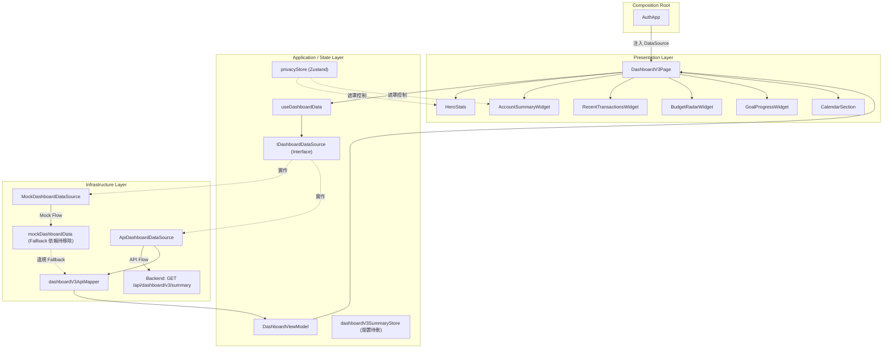
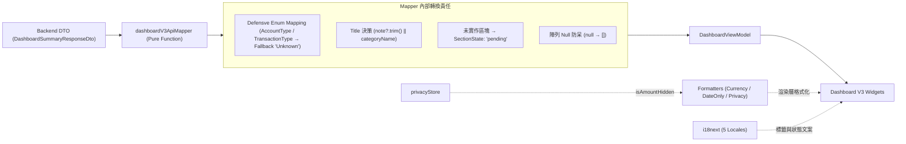
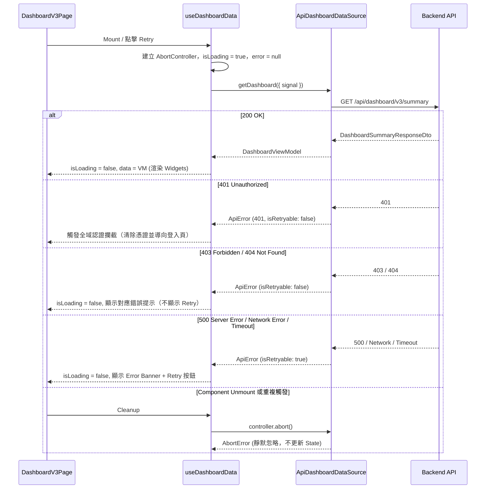

# Dashboard V3 Frontend Integration Specification

> **Document Path**: `docs/DashboardV3FrontendIntegrationSpec.md`
>
> **Status**: Active — Dashboard V3 Frontend API Integration Sprint 1 Source of Truth
>
> **Architecture Principles**: Clean Architecture · Dependency Inversion · Single Source of Truth · API-only Migration

---

## 1. Purpose

### Sprint 1 目標
本文件為 **Dashboard V3 Frontend API Integration Sprint 1** 的唯一規格依據（Source of Truth）。核心目標是將 Dashboard V3 從目前的 Hybrid（Mock + API 混合）資料流，安全且乾淨地遷移至 **API-only 架構**，徹底切斷正式環境程式碼對 `mockDashboardData` 的依賴。

### In Scope（本 Sprint 實作範圍）
* 對齊 Backend `GET /api/dashboard/v3/summary` 合約，建立前端 Infrastructure 層 DTO 與 Enum 型別。
* 重構 `dashboardV3ApiMapper` 為純函數（Pure Function），移除所有 `mockDashboardData` import 與 fallback 邏輯。
* 清理 `DashboardViewModel` 非核心欄位，引入 `SectionState` 明確區分 `ready`、`empty`、`pending` 狀態。
* 強化 `IDashboardDataSource`、`ApiDashboardDataSource` 與 `useDashboardData` 的非同步生命週期（`AbortSignal`、標準化 `ApiError`、`Retry`、Loading Skeleton）。
* 清除未使用的 `dashboardV3SummaryStore`，維持單一資料流。
* 補齊 `DateOnly` 安全格式化工具、Privacy Masking 整合與五語系（`zh-TW`, `en`, `pt-BR`, `ko`, `ja`）i18n 鍵值。
* 更新 Dashboard V3 元件以支援真實資料、Empty State、Pending State 與 Error State，並於 `AuthApp` 完成 `ApiDashboardDataSource` 正式切換。

### Out of Scope（本 Sprint 明確排除）
* 不實作 Calendar API、Budget API、Goal API 串接（歸屬未來 Sprint）。
* 不進行前端 Feature Slice 架構重構。
* 不導入新的 Server State 管理庫（如 TanStack Query、SWR）。
* 不修改既有 UI 視覺設計、排版與 Design Tokens。
* 不實作多幣別匯率換算（維持單一基準幣別）。
* 不實作 Offline Mode 或 Widget Plugin 系統。

---

## 2. Current Architecture

### Architecture & Dependency Flow

Dashboard V3 前端採用 Clean Architecture 依賴反轉原則：Presentation 層僅依賴 `useDashboardData` 與 `DashboardViewModel`，透過 `IDashboardDataSource` 介面與 Infrastructure 層解耦。目前存在的架構破口為 `dashboardV3ApiMapper` 反向依賴 `mockDashboardData` 作為 fallback，以及 `AuthApp` 尚未切換至 `ApiDashboardDataSource`。

### Mock Flow vs. API Flow 比較
* **Mock Flow（現況）**：`AuthApp → DashboardV3Page → useDashboardData → MockDashboardDataSource → mockDashboardData → DashboardViewModel`（同步/無錯誤/全假資料）。
* **API Flow（目標 API-only）**：`AuthApp → DashboardV3Page → useDashboardData (AbortController/Error/Retry) → ApiDashboardDataSource → GET /api/dashboard/v3/summary → dashboardV3ApiMapper (Pure) → DashboardViewModel (真實資料 + 明確 Pending 狀態)`。

---

## 3. Backend Contract

對應端點：`GET /api/dashboard/v3/summary`（JWT Bearer 驗證，無 Query Parameters，成功回傳 `200 OK`）。

### JSON Contract 欄位定義

#### `DashboardSummaryDto`

| 欄位名稱 | JSON 型別 | Nullable | 說明 |
| :--- | :--- | :---: | :--- |
| `totalAssets` | `number` | 否 | 所有 `!IsDeleted && !IsSystemAccount` 帳戶之 `CurrentBalance` 總和（純數值）。 |
| `todayExpense` | `number` | 否 | `businessDate` 當日 `TransactionType == Expense` 之支出總額（純數值）。 |
| `businessDate` | `string` | 否 | 後端計算「今日」的業務基準日期（`YYYY-MM-DD`，目前由後端 UTC Date 決定）。 |
| `accounts` | `AccountSummaryDto[]` | 否 | 活躍帳戶清單（無資料時回傳空陣列 `[]`，不可為 `null`）。 |
| `recentTransactions` | `RecentTransactionDto[]` | 否 | 最新 5 筆交易紀錄（無資料時回傳空陣列 `[]`，不可為 `null`）。 |

#### `AccountSummaryDto`

| 欄位名稱 | JSON 型別 | Nullable | 說明 |
| :--- | :--- | :---: | :--- |
| `id` | `string` (UUID) | 否 | 帳戶唯一識別碼。 |
| `name` | `string` | 否 | 使用者自訂帳戶名稱（不可翻譯）。 |
| `accountType` | `string` 或 `number` | 否 | 帳戶類型列舉（須於 Step 0 確認實際序列化格式）。 |
| `balance` | `number` | 否 | 帳戶目前餘額（純數值）。 |

#### `RecentTransactionDto`

| 欄位名稱 | JSON 型別 | Nullable | 說明 |
| :--- | :--- | :---: | :--- |
| `id` | `string` (UUID) | 否 | 交易唯一識別碼。 |
| `note` | `string` | **是** | 交易備註原始內容（可能為 `null` 或空字串）。 |
| `categoryName` | `string` | 否 | 分類名稱。 |
| `accountName` | `string` | 否 | 所屬帳戶名稱。 |
| `amount` | `number` | 否 | 交易金額（純數值）。 |
| `transactionType` | `string` 或 `number` | 否 | 交易類型（`Expense` / `Income` / `Transfer`）。 |
| `transactionDate` | `string` | 否 | 交易業務日期（`YYYY-MM-DD`）。 |

### Null 與排序規則
* **Null 規則**：陣列欄位（`accounts`, `recentTransactions`）後端預期回傳 `[]`，但前端 Mapper 仍須防禦性處理 `null / undefined` 轉為 `[]`；`note` 允許為 `null` 或空白字串。
* **排序規則**：`recentTransactions` 由後端保證依 `TransactionDate DESC`、同日依 `CreatedAtUtc DESC` 穩定排序（最多 5 筆）；前端不重複排序，直接依序渲染。
* **BusinessDate**：代表後端計算 `todayExpense` 的基準日，前端僅透過 `DateOnly Formatter` 格式化顯示，不進行時區偏移推算。

### 前端對應狀態盤點

| 狀態分類 | 具體項目 |
| :--- | :--- |
| **已完成** | `IDashboardDataSource` 介面抽象、`ApiDashboardDataSource` 基礎骨架、`DashboardViewModel` 基礎結構、`privacyStore` 狀態管理。 |
| **缺少** | `DashboardSummaryResponseDto`（含 `businessDate`, `accounts[]`）正式型別、`SectionState<T>` 型別、`DateOnly` 安全格式化工具、五語系 Pending/Empty/Error/AccountType 翻譯鍵值、`AbortSignal` 與 `ApiError` 機制。 |
| **需要修改** | `dashboardV3ApiMapper`（移除 Mock Fallback、加入 Enum 防禦映射）、`useDashboardData`（補齊生命週期）、`AuthApp`（切換 DataSource）、所有 Dashboard Widgets（補齊 Empty / Pending / Error 防呆）。 |
| **阻塞項目（須於 Step 0 確認）** | 1. 確認後端 `RecentTransactionDto` 實際 JSON 是否已包含 `transactionType`。 2. 確認 `accountType` 與 `transactionType` 序列化格式為字串或整數。 3. 確認 `note` 實際回傳 `null` 或 `""`。 |

---

## 4. Current Mock Analysis

| 分類 | Mock 資料項目 | 目前用途 | 位置 | Migration Strategy |
| :--- | :--- | :--- | :--- | :--- |
| **Backend 已覆蓋** | `totalAssets`, `todayExpense` | 渲染 Hero Stats 核心數值 | `mockDashboardData` / `dashboardV3ApiMapper` | **移除 Fallback**，直接由 Summary API 映射。 |
| **Backend 已覆蓋** | `accounts[]` | 渲染 Account Summary 帳戶清單 | `mockDashboardData` / `dashboardV3ApiMapper` | **移除 Fallback**，改接 Summary API `accounts[]`。 |
| **Backend 已覆蓋** | `recentTransactions[]` | 渲染 Recent Transactions 列表 | `mockDashboardData` / `dashboardV3ApiMapper` | **移除 Fallback**，改接 Summary API `recentTransactions[]`。 |
| **待 API** | `remainingBudget` | Hero Stats 顯示本月剩餘預算 | `mockDashboardData` / `dashboardV3ApiMapper` | **改為 Pending (`null`)**，待 Budget Contract 完成後接入。 |
| **待 API** | `budgetRadar` | 渲染 BudgetRadarWidget | `mockDashboardData` / `dashboardV3ApiMapper` | **改為 Pending State**，禁止顯示假預算進度。 |
| **待 API** | `goalProgress` | 渲染 GoalProgressWidget | `mockDashboardData` / `dashboardV3ApiMapper` | **改為 Pending State**，禁止顯示假目標進度。 |
| **待 API** | `calendar` | 渲染 CalendarSection 與單日明細 | `mockDashboardData` / `dashboardV3ApiMapper` | **改為 Pending State**，等待 Sprint 2 Calendar API。 |
| **可刪除** | `assetChange`, `savingRate` | 非 V3 核心統計指標 | `DashboardViewModel` / `mockDashboardData` | **直接刪除**（歸屬未來 Reports 頁面）。 |
| **可刪除** | `contributionHistory` | 目標歷史投入紀錄 | `DashboardViewModel` / `mockDashboardData` | **直接刪除**（歸屬 Goal Detail 頁面）。 |
| **保留（限測試）** | `MockDashboardDataSource` | 本地開發預覽與單元測試 Fixture | Infrastructure / Tests | **僅保留於測試與開發工具**，嚴禁進入正式環境資料流與 `dashboardV3ApiMapper`。 |

---

## 5. DTO → ViewModel Mapping

### Mapping Flow Diagram

### 完整映射對照表

| Backend DTO | Frontend ViewModel | UI Component | Formatter | Privacy (`ADR-PrivacyDisplay`) | i18n |
| :--- | :--- | :--- | :--- | :--- | :--- |
| `totalAssets` | `heroStats.totalAssets` | `HeroStats` | Currency + Privacy | **強制遮罩** (`••••••`) | 標題標籤翻譯 |
| `todayExpense` | `heroStats.spentToday` | `HeroStats` | Currency + Privacy | **強制遮罩** (`••••`) | 標題標籤翻譯 |
| *(無)* | `heroStats.remainingBudget` | `HeroStats` | 無（顯示 `—`） | 不適用（Pending） | Pending 標籤 |
| `businessDate` | `meta.businessDate` | `HeroStats` | DateOnly Formatter | 不遮罩 | 依語系顯示 |
| `accounts[].id` | `accountSummary.items[].id` | `AccountSummaryWidget` | 無 | 不遮罩 | 無 |
| `accounts[].name` | `accountSummary.items[].name` | `AccountSummaryWidget` | 無 | 不遮罩 | **不翻譯**（使用者輸入） |
| `accounts[].accountType` | `accountSummary.items[].type` | `AccountSummaryWidget` | Enum Mapping | 不遮罩 | `dashboard.accountType.*` |
| `accounts[].balance` | `accountSummary.items[].balance` | `AccountSummaryWidget` | Currency + Privacy | **強制遮罩** (`••••`) | 無 |
| `totalAssets` | `accountSummary.totalBalance` | `AccountSummaryWidget` | Currency + Privacy | **強制遮罩** (`••••••`) | 標籤翻譯 |
| `recentTransactions[].id` | `recentTransactions.items[].id` | `RecentTransactionsWidget` | 無 | 不遮罩 | 無 |
| `recentTransactions[].note` | `recentTransactions.items[].title` | `RecentTransactionsWidget` | Trim（空值退回 `categoryName`） | 不遮罩 | **不翻譯** |
| `recentTransactions[].categoryName` | `recentTransactions.items[].categoryName` | `RecentTransactionsWidget` | 無 | 不遮罩 | 系統分類翻譯 |
| `recentTransactions[].accountName` | `recentTransactions.items[].accountName` | `RecentTransactionsWidget` | 無 | 不遮罩 | **不翻譯** |
| `recentTransactions[].amount` | `recentTransactions.items[].amount` | `RecentTransactionsWidget` | Currency（依 Type 加正負號） | **可選遮罩** | 無 |
| `recentTransactions[].transactionType` | `recentTransactions.items[].type` | `RecentTransactionsWidget` | Enum Mapping（決定色票） | 不遮罩 | 無 |
| `recentTransactions[].transactionDate` | `recentTransactions.items[].date` | `RecentTransactionsWidget` | DateOnly Formatter | 不遮罩 | 依語系格式 |

---

## 6. Frontend Types

| 變更類型 | 型別名稱 | 所屬分層 | 用途與邊界說明 |
| :--- | :--- | :--- | :--- |
| **新增** | `DashboardSummaryResponseDto`, `AccountSummaryDto`, `RecentTransactionDto` | Infrastructure | 精準對應 Backend JSON Contract，嚴禁被 Presentation 層 import。 |
| **新增** | `AccountType`, `TransactionType` | Application / Shared | 前端標準語意列舉，兩者皆須包含 `'Unknown'` 作為防禦性降級值。 |
| **新增** | `SectionState<T>` | Application / ViewModel | 聯合型別，明確區分區塊狀態：`ready`（含 `data`）、`empty`、`pending`。 |
| **新增** | `ApiError` | Infrastructure / Application | 標準化錯誤模型（`status`, `code`, `message`, `isRetryable`），對應後端 `ProblemDetails`。 |
| **新增** | `DashboardFetchOptions` | Application | 傳遞給 `IDashboardDataSource` 的請求選項，包含 `signal?: AbortSignal`。 |
| **修改** | `DashboardViewModel` | Application / ViewModel | 新增 `meta.businessDate`，將 `budgetRadar`、`goalProgress`、`calendar` 包裝為 `SectionState`。 |
| **刪除** | `assetChange`, `savingRate`, `contributionHistory` | ViewModel | 移除非 Dashboard V3 必要欄位，避免殘留無效型別。 |

---

## 7. Component Impact Analysis

| Component | 修改原因 | 新增 | 刪除 | Loading | Empty | Pending | Error |
| :--- | :--- | :--- | :--- | :--- | :--- | :--- | :--- |
| **`DashboardV3Page`** | 承接真實 API 非同步生命週期。 | Skeleton 狀態切換、Error Banner、`Retry` 按鈕。 | 對 Mock 永不失敗的隱性假設。 | 全頁等高 Skeleton。 | 委派各子元件。 | 委派各子元件。 | 顯示錯誤提示與 Retry，不白屏。 |
| **`HeroStats`** | 接上真實 `totalAssets`、`todayExpense`、`businessDate`。 | `remainingBudget` 為 `null` 時顯示 `—`；套用共用 Privacy Formatter。 | `assetChange`、`savingRate` 渲染。 | 數值骨架屏。 | 新用戶顯示 `0`。 | `remainingBudget` 顯示 `—`。 | 隨主頁處理。 |
| **`AccountSummaryWidget`** | 接上真實 `accounts[]` 與 `totalAssets`。 | `AccountType` 圖示與 i18n；強制套用 `privacyStore` 遮罩。 | 假帳戶預設值。 | 列表骨架屏。 | 「尚無帳戶」空狀態與引導。 | 不適用。 | 隨主頁處理。 |
| **`RecentTransactionsWidget`** | 接上真實 `recentTransactions[]` 與 `transactionType`。 | 依 `type` 顯示正負號與色票；`note` 空值 fallback 至 `categoryName`。 | 金額正負號猜測邏輯。 | 5 筆列表骨架屏。 | 「尚無交易紀錄」空狀態。 | 不適用。 | 隨主頁處理。 |
| **`BudgetRadarWidget`** | 移除 Mock Fallback，杜絕假數據。 | `SectionState === 'pending'` 專屬卡片渲染。 | 假預算進度條渲染。 | 骨架屏。 | 不適用。 | 顯示「預算雷達準備中」。 | 不適用。 |
| **`GoalProgressWidget`** | 移除 Mock Fallback，杜絕假數據。 | `SectionState === 'pending'` 專屬卡片渲染。 | `contributionHistory` 與假目標渲染。 | 骨架屏。 | 不適用。 | 顯示「目標進度準備中」。 | 不適用。 |
| **`CalendarSection`** | 移除 Mock Fallback，等待 Sprint 2 Calendar API。 | `SectionState === 'pending'` 專屬卡片渲染。 | 假月曆標記渲染。 | 骨架屏。 | 不適用。 | 顯示「月曆檢視即將開放」。 | 不適用。 |

---

## 8. Store Impact

| 模組 / Store | 決策 | 原因與修改說明 |
| :--- | :--- | :--- |
| **`useDashboardData`** | **修改** | 維持為 Dashboard V3 唯一資料 Hook。補齊 `AbortController`（Unmount 自動取消）、`isLoading`、`error: ApiError \| null` 與 `retry()` 方法，並靜默忽略 `AbortError`。 |
| **`dashboardV3SummaryStore`** | **刪除** | 確認全專案無任何元件或 Hook 引用後直接刪除，避免與 `useDashboardData` 形成雙重狀態來源（Split-Brain State）。 |
| **`privacyStore`** | **保留** | 維持 `isAmountHidden` 與 `localStorage` 持久化（僅存 UI Preference）。驗證 `HeroStats` 與 `AccountSummaryWidget` 皆已正確訂閱。 |

---

## 9. API Layer

*   **`IDashboardDataSource`**：
    *   定義唯一讀取合約，接受 `DashboardFetchOptions`（含 `signal?: AbortSignal`），回傳 `Promise<DashboardViewModel>`。
    *   嚴格隔離 Backend DTO，不暴露任何 HTTP 細節。
*   **`ApiDashboardDataSource`**：
    *   呼叫底層 HTTP Client / Repository 取得 `GET /api/dashboard/v3/summary`，並透傳 `AbortSignal`。
    *   捕捉所有 HTTP 非 2xx 與網路異常，統一轉換為標準化 `ApiError` 拋出（區分 `isRetryable`）。
    *   呼叫 `dashboardV3ApiMapper` 將 DTO 轉為 `DashboardViewModel`。
*   **`dashboardV3ApiMapper`**：
    *   純函數轉換器，**嚴禁 import `mockDashboardData`**，不執行任何副作用或 API 呼叫。
    *   負責防禦性 Enum 映射、陣列 Null 防呆、`Title` 決策與 Pending State 組裝。
*   **Repository（既有底層 HTTP Client）**：
    *   僅負責 Base URL、JWT Authorization Header 注入與基礎 `fetch` / `axios` 封裝，不介入業務映射。

---

## 10. Formatter

1.  **Currency Formatter**：
    *   統一使用 `Intl.NumberFormat` 處理千分位與單一基準幣別符號，禁止執行匯率換算。
    *   支援傳入 `TransactionType` 決定前置正負號（`Income` 為 `+`、`Expense` 為 `-`、`Transfer` 無正負號）。
2.  **Privacy Formatter**：
    *   整合於 Currency Formatter 或作為包裝層；當 `isAmountHidden === true` 時，依 `ADR-PrivacyDisplay.md` 統一回傳遮罩字串（總資產 `••••••`、一般金額 `••••`）。
3.  **DateOnly Formatter（安全策略）**：
    *   **嚴格禁止**：`new Date("YYYY-MM-DD")`（ECMAScript 規範會將純日期字串解析為 UTC 00:00，在負時區如 `pt-BR` UTC-3 會偏移成前一天）。
    *   **安全策略**：將 `YYYY-MM-DD` 以 `-` 拆解為整數 `year`、`month`、`day`，使用本地日期建構方式建立日期物件（`month - 1`），再交由 `Intl.DateTimeFormat` 依當前 i18n 語系格式化；若字串格式異常則安全退回原字串。
4.  **Date Formatter**：
    *   專責處理含完整時間戳記（ISO 8601 DateTime）之顯示，與 `DateOnly Formatter` 職責分離。

---

## 11. i18n

所有新增翻譯鍵值必須同步補齊五語系：**`zh-TW`**、**`en`**、**`pt-BR`**、**`ko`**、**`ja`**。

| 分類 | Translation Keys | 用途 |
| :--- | :--- | :--- |
| **AccountType** | `dashboard.accountType.bank`, `.cash`, `.creditCard`, `.investment`, `.unknown` | 帳戶類型顯示名稱。 |
| **Pending** | `dashboard.pending.budgetTitle`, `.goalTitle`, `.calendarTitle`, `.description` | 未接入 API 區塊的正式說明文案。 |
| **Empty** | `dashboard.empty.accounts`, `.recentTransactions`, `.ctaAddAccount`, `.ctaAddTransaction` | 新使用者無資料時的空狀態與引導按鈕。 |
| **Error** | `dashboard.error.network`, `.timeout`, `.unauthorized`, `.forbidden`, `.notFound`, `.serverError`, `.generic` | 依 `ApiError` 類型顯示的錯誤文案。 |
| **Retry** | `dashboard.actions.retry` | 錯誤狀態重新載入按鈕文案。 |

---

## 12. Error Handling

*   **Loading Skeleton**：首次載入與點擊 `Retry` 時，顯示與正式卡片等高的 Skeleton，避免版面跳動（CLS）。
*   **Timeout**：底層 HTTP Client 應設定合理請求超時，超時後轉譯為可重試的 `ApiError`。

---

## 13. Risk Analysis

| 項目 | Risk | Cause | Impact | Recommendation |
| :--- | :--- | :--- | :--- | :--- |
| **Enum Mapping** | 未知列舉值導致 Runtime 崩潰 | 後端新增 Enum 或序列化格式（字串 vs 數字）不符 | 整頁白屏或卡片報錯 | Mapper 強制實作 `Unknown` fallback，並於 Step 0 確認後端實際回傳格式。 |
| **TransactionType** | 收支方向與色票顯示錯誤 | 誤以 `amount < 0` 推測，或缺少 `transactionType` 欄位 | 支出誤顯示為收入，破壞財務準確性 | 嚴格依 `transactionType` 映射；若後端尚未暴露此欄位，須先補齊 Backend DTO。 |
| **AccountType** | 帳戶類型顯示原始 Key 或缺圖示 | 未同步補齊五語系 Key 或漏掉 `unknown` 預設值 | UI 破版或顯示未翻譯字串 | 建立完整五語系 Key 與通用預設圖示。 |
| **DateOnly** | 負時區使用者看到日期少一天 | 使用 `new Date("YYYY-MM-DD")` 觸發 UTC 轉本地時區 | `pt-BR` 語系顯示錯誤交易日期 | 全面禁用 `new Date("YYYY-MM-DD")`，改用字串拆解之 `DateOnly Formatter`。 |
| **Currency** | 金額格式不統一或誤做匯率換算 | 各元件各自實作格式化 | 金額顯示錯亂 | 收斂至共用 `Intl.NumberFormat` Currency Formatter，維持單一基準幣別。 |
| **Privacy** | 真實帳戶餘額在隱私模式下外洩 | `AccountSummaryWidget` 接入真實 API 後忘記套用遮罩 | 公開場合暴露真實存款 | 將 Privacy Masking 整合進共用 Formatter，驗收時逐項檢查。 |
| **Empty State** | 新用戶登入後發生 Null Reference 崩潰 | 殘留 Mock 永遠有資料的假設 | 新用戶無法使用首頁 | Mapper 保證陣列永不為 `null`，所有列表 Widget 必做 `length === 0` 處理。 |
| **Pending State** | 正式環境殘留假預算與假目標 | 未徹底清除 `mockDashboardData` fallback | 真假資料混合，嚴重損害產品信任 | 強制移除 Mapper 所有 Mock import，未實作區塊明確顯示 Pending。 |
| **Race Condition** | 舊請求覆蓋新狀態或 Unmount 警告 | 切換頁面或快速重試時未取消前次請求 | 顯示過期資料或記憶體洩漏 | `useDashboardData` 全面整合 `AbortController` 並靜默忽略 `AbortError`。 |
| **API Failure** | 後端短暫異常導致整頁白屏 | 未捕捉例外或缺乏 Error UI | 使用者卡死無法恢復 | 統一轉譯為 `ApiError`，提供友善錯誤文案與 `Retry` 按鈕。 |

---

## 14. Acceptance Criteria

*   [ ] **Mock 完全移除**：`dashboardV3ApiMapper` 與正式環境程式碼完全不 import `mockDashboardData`。
*   [ ] **API-only 切換**：`AuthApp` 已正式注入 `ApiDashboardDataSource` 作為唯一正式資料來源。
*   [ ] **殭屍 Store 清除**：`dashboardV3SummaryStore` 已確認無引用並移除。
*   [ ] **Widget 渲染正確**：`HeroStats`、`AccountSummaryWidget`、`RecentTransactionsWidget` 正確顯示真實資料；`BudgetRadarWidget`、`GoalProgressWidget`、`CalendarSection` 正確顯示 Pending State。
*   [ ] **Empty State 正常**：模擬後端回傳 `totalAssets: 0`, `accounts: []`, `recentTransactions: []` 時，畫面正常無報錯。
*   [ ] **Error & Loading 正常**：模擬延遲、401、500、Timeout 與 Unmount 時，Skeleton、錯誤提示、`Retry` 與 `AbortController` 皆正常運作。
*   [ ] **Formatter & Privacy 正確**：Privacy Mode 正確遮罩 `HeroStats` 與 `AccountSummaryWidget`；`DateOnly` 在負時區無日期偏移。
*   [ ] **i18n 完整**：`zh-TW`, `en`, `pt-BR`, `ko`, `ja` 五語系無缺漏鍵值。
*   [ ] **Build & Test 通過**：TypeScript 編譯零錯誤、Production Build 成功、所有 Unit Tests 全數綠燈。

---

## 15. Implementation Order

每完成一個 Step 皆須執行對應的 Build Check 與 Test Check，確保漸進式演進零破壞。

| Step | 任務項目 | 目的與原因 | 完成條件 | Build / Test Check |
| :---: | :--- | :--- | :--- | :--- |
| **0** | **本機程式碼與合約核對** | 以實際程式碼為主，確認檔案路徑、Enum 序列化格式、`transactionType` 是否存在及 `dashboardV3SummaryStore` 引用狀態，避免盲目修改。 | 列出所有「Spec vs Current Code Gap」並確認無阻塞項。 | 無需 Build。 |
| **1** | **DTO Types & Enum Types** | 先凍結 Infrastructure 層與後端對接的型別合約。 | 新增 `DashboardSummaryResponseDto`、`AccountSummaryDto`、`RecentTransactionDto`、`AccountType`、`TransactionType`、`ApiError`、`DashboardFetchOptions`。 | `tsc --noEmit` 通過。 |
| **2** | **ViewModel Types** | 先清理非 V3 欄位並導入 `SectionState<T>`，讓 TypeScript 編譯器直接標出所有受影響處。 | 更新 `DashboardViewModel`，移除 `assetChange`、`savingRate`、`contributionHistory`。 | 確認型別定義本身無語法錯誤。 |
| **3** | **Formatter** | 在修改 Mapper 與元件前備妥純工具函式，防止重複實作與時區 Bug。 | 完成 Currency、Privacy 與安全 `DateOnly` Formatter。 | Build 通過；補齊 `DateOnly` 與 Privacy Formatter Unit Tests。 |
| **4** | **Mapper 重構** | 徹底切斷生產程式碼對 `mockDashboardData` 的依賴，收斂為純函數。 | `dashboardV3ApiMapper` 零 Mock import，具備 Enum fallback、Null 防呆與 Pending 映射。 | Build 通過；補齊 Mapper Unit Tests（正常、空值、未知 Enum、`note` 為空）。 |
| **5** | **DataSource & API Layer** | 補齊請求取消與錯誤標準化邊界。 | `IDashboardDataSource` 與 `ApiDashboardDataSource` 支援 `AbortSignal` 與 `ApiError` 轉換。 | Build 通過；既有測試通過。 |
| **6** | **Hooks & Store 清理** | 強化非同步生命週期並消除殭屍 Store。 | `useDashboardData` 支援 `AbortController`、`error`、`retry`；刪除 `dashboardV3SummaryStore`。 | Build 通過；補齊 Hook Unit Tests。 |
| **7** | **i18n 五語系補齊** | 在修改 UI 前備妥所有翻譯鍵值，避免缺 Key。 | 五語系 JSON 補齊 `AccountType`、`Pending`、`Empty`、`Error`、`Retry`。 | Build 通過；驗證 JSON 格式合法。 |
| **8** | **Components & `AuthApp` 切換** | 完成 UI 狀態防呆並正式切換為 API-only。 | 更新 `DashboardV3Page` 與 6 個 Widgets；`AuthApp` 注入 `ApiDashboardDataSource`。 | Build 通過；手動驗證 Loading / Empty / Pending / Error / Privacy。 |
| **9** | **全套測試與最終 Build** | 驗證整體整合品質與 Acceptance Criteria。 | 逐項勾選 Section 14 Acceptance Criteria。 | 完整 Production Build + 全部 Unit Tests 綠燈通過。 |

---

## 16. Spec vs Current Code Gap

本專章記錄規格與目前已知程式碼現況之間的差異，以及 Step 0 必須以本機實際程式碼為準進行核對的項目：

| 差異項目 | 規格期望（Target） | 目前已知程式碼現況 / 待核對點 | 處置原則 |
| :--- | :--- | :--- | :--- |
| **Mapper Mock Fallback** | `dashboardV3ApiMapper` 為純函數，零 Mock 依賴。 | 目前仍 import `mockDashboardData` 作為缺失欄位 fallback。 | **必須修正**：Sprint 1 徹底移除。 |
| **`AuthApp` DataSource 注入** | 正式注入 `ApiDashboardDataSource`。 | 目前尚未正式切換，仍指向 Mock。 | **必須修正**：於 Step 8 完成切換。 |
| **`dashboardV3SummaryStore`** | 單一資料流，僅由 `useDashboardData` 管理。 | 專案中仍殘留疑似未使用的 `dashboardV3SummaryStore`。 | **須核對後刪除**：Step 0 確認零引用後移除。 |
| **`RecentTransactionDto.transactionType`** | DTO 明確提供 `transactionType` 區分收支方向。 | 早期 Sprint 1 後端規格未明列此欄位，需核對本機後端實際回傳 JSON。 | **阻塞檢查**：若後端未回傳，須先補齊後端 DTO，禁止前端猜測正負號。 |
| **Enum 序列化格式** | 前端 Mapper 精準對應後端輸出。 | 尚未核對後端 `AccountType` / `TransactionType` 是輸出字串或整數。 | **以實際程式為主**：Step 0 檢視後端實際回傳值後決定 Mapper 對應表。 |
| **`DashboardViewModel` 欄位** | 僅保留 V3 核心欄位並使用 `SectionState`。 | 可能殘留 `assetChange`、`savingRate`、`contributionHistory`。 | **以實際程式為主**：Step 0 盤點並移除未使用的冗餘欄位。 |

---

## 17. Future Sprint Boundary

為防止 Sprint 1 Scope 擴散，以下明確切分後續各 Sprint 的演進邊界：

*   **Sprint 1（本文件範圍）**：Dashboard Summary API-only 遷移、移除 `mockDashboardData`、補齊 Empty / Pending / Error / Loading 狀態、`AuthApp` 正式切換。
*   **Sprint 2（Calendar API Integration）**：
    *   Backend 實作 `GET /api/dashboard/v3/calendar` 與 `GET /api/dashboard/v3/calendar/day`。
    *   Frontend 於現有 `ApiDashboardDataSource` 接入 Calendar API，將 `CalendarSection` 從 `Pending` 升級為真實資料。
*   **Sprint 3（Server State Cache & Feature Slicing）**：
    *   評估導入 TanStack Query 取代手動 `useEffect` 資料抓取，建立跨 Widget 的 Query Invalidation（例如新增交易後自動刷新 Summary 與 Calendar）。
    *   將單體 `IDashboardDataSource` 與 `DashboardViewModel` 依 Feature 切片拆分。
*   **Sprint 4+（Domain Read Models & 長期演進）**：
    *   接入 `GoalFundingSummary` Read Model，啟用 `GoalProgressWidget`。
    *   釐清 Budget vs. Cash Flow 業務邊界後，啟用 `BudgetRadarWidget` 與 `HeroStats.remainingBudget`。
    *   長期擴充評估：Multi-Currency、Offline Persist、Realtime Update 與 Widget Plugin System。