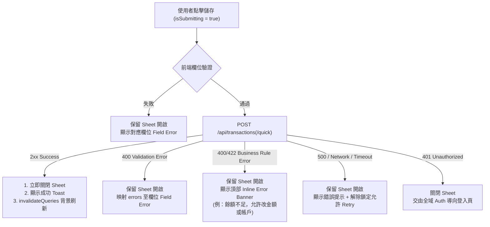

# Dashboard V4 Error Handling Specification

> **Document Path**: `docs/DashboardV4ErrorHandlingSpec.md`
>
> **Status**: Accepted
>
> **Scope**: Dashboard V4 全域 API 錯誤契約與 `TransactionBottomSheet` 完整狀態生命週期。

---

## 1. Standard Error Contract (RFC 7807 `ProblemDetails`)

所有 Backend `4xx` / `5xx` 錯誤一律回傳標準 RFC 7807 格式，前端依據 `status` 與語意 `type` 決定 UI 呈現方式（不解析自由文字 `detail` 做邏輯判斷）：

```json
{
  "type": "[https://api.lifedashboard/errors/insufficient-balance](https://api.lifedashboard/errors/insufficient-balance)",
  "title": "Insufficient Balance",
  "status": 400,
  "detail": "Account balance is insufficient for this expense.",
  "errors": {
    "amount": ["Amount exceeds current account balance."]
  }
}
```

### 標準錯誤類型分類

| `status` | `type` (語意識別) | 分類 | 說明 |
| :---: | :--- | :--- | :--- |
| `400` | `.../errors/validation-failed` | Validation Error | 欄位格式或必填驗證失敗（含 `errors` 字典）。 |
| `400` / `422` | `.../errors/insufficient-balance` 等 | Business Rule Error | 違反領域規則（如餘額不足、帳戶已停用）。 |
| `422` | `.../errors/no-cashflow-account` | Business Validation Error | 使用者尚未建立可用的 Cashflow 帳戶。 |
| `401` | `.../errors/unauthorized` | Auth Error | JWT 過期或未授權。 |
| `500` / Timeout | `.../errors/internal-server-error` / Network | Network / Server Error | 伺服器異常或網路中斷。 |

---

## 2. TransactionBottomSheet Lifecycle & Error Flow Rule

`TransactionBottomSheet` 送出後的唯一關閉條件是 **API 成功（2xx）** 或 **授權失效（401）**；任何可由使用者修正或重試的錯誤，皆必須**保留 Sheet 開啟與表單輸入內容**。



### Transaction Error Flow Rule 總表

| Error Type | Sheet 狀態 | UI 呈現行為 | 使用者下一步 |
| :--- | :--- | :--- | :--- |
| **Validation Error** | **保留開啟** | 對應欄位下方顯示 Field Error，保留輸入值。 | 修正錯誤欄位後重送。 |
| **Business Rule Error**（如 `InsufficientFundsException`） | **保留開啟** | 表單內顯示 Inline Error Banner，保留輸入值。 | 調整金額、切換帳戶或更改類型後重送。 |
| **Network / 5xx Error** | **保留開啟** | 表單內顯示網路異常提示 + Retry 按鈕，保留輸入值。 | 直接點擊重試，不遺失輸入。 |
| **401 Unauthorized** | **關閉** | 交由全域攔截器處理並導向登入頁。 | 重新登入。 |
| **Success (2xx)** | **立即關閉** | 顯示輕量 Toast + 背景 `invalidateQueries`。 | 繼續瀏覽或記下一筆。 |

---

## 3. Quick Create Domain Rule 補充鎖定

為避免 `POST /api/transactions/quick` 在不同開發者手中產生分歧，預設值解析明確收斂於 Backend Application/Domain 層（嚴禁寫在 Controller）：

* **Default Account 解析順序（嚴格依序 Fallback）**：
  1. `UserPreference.DefaultExpenseAccountId`：僅接受目前使用者擁有、未刪除、非系統且類型為 `Cashflow` 的帳戶。
  2. 最近 30 天 Expense 使用最多的有效 `Cashflow` 帳戶。
  3. 第一個有效 `Cashflow` 帳戶（`CreatedAtUtc ASC`, `Id ASC`）。
  4. 若沒有有效 `Cashflow` 帳戶，回傳 HTTP `422` ProblemDetails，type 為 `https://api.lifedashboard/errors/no-cashflow-account`。
* **Default Category 解析順序（嚴格依序 Fallback）**：
  1. `User Default Category`：使用者設定且屬於目前使用者的預設分類。
  2. `Recent Category (Last Used)`：使用者最近一次記帳使用的分類。
  3. `Most Used Category (30 days)`：若無明確最近紀錄，取最近 30 天內使用頻率最高的分類。
  4. `Uncategorized`：系統保底未分類。
* **Default Date**：後端 `businessDate`（今日）。