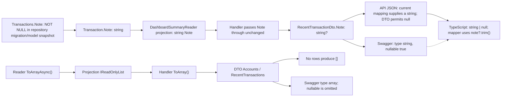

# Nullable Contract Audit

> **Document Path**: `docs/NullableContractAudit.md`  
> **Audit Date**: 2026-11-24  
> **Audit Scope**: Dashboard V3 Summary DTOs, their Account/Transaction data flow, and the live Swagger schema.

## 1. Audit Summary

The audit re-checked the repository sources and the Swagger document served at `https://localhost:7162/swagger/v1/swagger.json` (HTTP 200). It did not rely on the previous audit's unverified conclusions.

| Status | Count | Result |
| :--- | :---: | :--- |
| **OK** | 3 | Summary collections are built as arrays; canonical enum strings and date fields are non-null in the current mapping and schema. |
| **Warning** | 2 | `Note` is nullable at the API boundary while its persisted source is non-null; Swagger also does not declare these DTO properties as required. Neither is a current null-response failure. |
| **Breaking Risk** | 0 | No evidence that the audited Dashboard V3 Summary flow emits null for a field the frontend treats as non-null. |
| **Unknown - Not Found In Repository** | 1 | The physical schema of the currently deployed database was not inspected; the repository migration and model snapshot define `Transactions.Note` as NOT NULL. |

### Sources Checked

- DTOs and mappings: [DashboardSummaryDto.cs](../LifeDashboard.Application/Features/Dashboard/Dtos/DashboardSummaryDto.cs), [DashboardAccountDto.cs](../LifeDashboard.Application/Features/Dashboard/Dtos/DashboardAccountDto.cs), [RecentTransactionDto.cs](../LifeDashboard.Application/Features/Dashboard/Dtos/RecentTransactionDto.cs), [GetDashboardSummaryQueryHandler.cs](../LifeDashboard.Application/Features/Dashboard/Queries/GetDashboardSummaryQueryHandler.cs), [DashboardSummaryProjection.cs](../LifeDashboard.Application/Features/Dashboard/Models/DashboardSummaryProjection.cs), [DashboardAccountProjection.cs](../LifeDashboard.Application/Features/Dashboard/Models/DashboardAccountProjection.cs), and [RecentTransactionProjection.cs](../LifeDashboard.Application/Features/Dashboard/Models/RecentTransactionProjection.cs).
- Entities and persistence: [Account.cs](../LifeDashboard.Domain/Entities/Account.cs), [Transaction.cs](../LifeDashboard.Domain/Entities/Transaction.cs), [LifeDashboardDbContext.cs](../LifeDashboard.Infrastructure/Data/LifeDashboardDbContext.cs), [DashboardSummaryReader.cs](../LifeDashboard.Infrastructure/Repositories/DashboardSummaryReader.cs), [20261105015639_InitialCreate.cs](../LifeDashboard.Infrastructure/Migrations/20261105015639_InitialCreate.cs), and [LifeDashboardDbContextModelSnapshot.cs](../LifeDashboard.Infrastructure/Migrations/LifeDashboardDbContextModelSnapshot.cs).
- Swagger configuration: [Program.cs](../LifeDashboard.Api/Program.cs). Runtime schema was fetched from `https://localhost:7162/swagger/v1/swagger.json`.
- Frontend handling: [RecentTransactionDto.ts](../LifeDashboard.Web/src/infrastructure/dashboard/api/RecentTransactionDto.ts) and [recentTransactionMapper.ts](../LifeDashboard.Web/src/infrastructure/dashboard/mappers/recentTransactionMapper.ts).

## 2. Contract Flow Diagram

The database node above describes the repository's expected schema, not a direct inspection of the deployed database.

## 3. Findings

### `RecentTransactionDto.Note` — Warning, not a Breaking Risk

- **Entity and database:** `Transaction.Note` is declared as `string` and initialized to `string.Empty` in [Transaction.cs](../LifeDashboard.Domain/Entities/Transaction.cs). Nullable reference types are enabled in the Domain project. The initial migration creates `Transactions.Note` with `nullable: false`, and the model snapshot marks it required in [20261105015639_InitialCreate.cs](../LifeDashboard.Infrastructure/Migrations/20261105015639_InitialCreate.cs) and [LifeDashboardDbContextModelSnapshot.cs](../LifeDashboard.Infrastructure/Migrations/LifeDashboardDbContextModelSnapshot.cs). `LifeDashboardDbContext` has no explicit `Note.IsRequired()` call; the repository model and migration still define the column as required.
- **Projection and mapping:** [RecentTransactionProjection.cs](../LifeDashboard.Application/Features/Dashboard/Models/RecentTransactionProjection.cs) declares `Note` as `string`. [DashboardSummaryReader.cs](../LifeDashboard.Infrastructure/Repositories/DashboardSummaryReader.cs) selects `transaction.Note`, and [GetDashboardSummaryQueryHandler.cs](../LifeDashboard.Application/Features/Dashboard/Queries/GetDashboardSummaryQueryHandler.cs) passes `transaction.Note` directly to the DTO. The declared mapping path does not produce null.
- **DTO and Swagger:** [RecentTransactionDto.cs](../LifeDashboard.Application/Features/Dashboard/Dtos/RecentTransactionDto.cs) declares `Note` as `string?`. The live Swagger schema reports `note` as `type: string, nullable: true`.
- **Frontend:** [RecentTransactionDto.ts](../LifeDashboard.Web/src/infrastructure/dashboard/api/RecentTransactionDto.ts) declares `note: string | null`; [recentTransactionMapper.ts](../LifeDashboard.Web/src/infrastructure/dashboard/mappers/recentTransactionMapper.ts) uses `note?.trim()`.
- **Assessment:** The Entity and repository schema are stricter than the API DTO, but the DTO, Swagger, and frontend agree that the API may represent a null note. The current reader-to-handler mapping supplies the non-null Entity value, so this is a permissive API contract, not evidence of a breaking null flow. Do not remove the DTO nullability without an API contract decision.

### Summary Collections — OK at Runtime

- [DashboardSummaryDto.cs](../LifeDashboard.Application/Features/Dashboard/Dtos/DashboardSummaryDto.cs) accepts non-null `IReadOnlyList<T>` constructor arguments; it does not initialize either collection with `= []`.
- [DashboardSummaryReader.cs](../LifeDashboard.Infrastructure/Repositories/DashboardSummaryReader.cs) materializes both collections using `ToArrayAsync()`. [GetDashboardSummaryQueryHandler.cs](../LifeDashboard.Application/Features/Dashboard/Queries/GetDashboardSummaryQueryHandler.cs) maps them using `ToArray()` before constructing the DTO.
- Consequently, an empty query result produces an empty array, not null, along this application path. The live Swagger schema represents `accounts` and `recentTransactions` as arrays without `nullable: true`.
- This is a mapping guarantee rather than a DTO default initializer or runtime null guard.

### Canonical Enum Fields — OK

- [DashboardSummaryReader.cs](../LifeDashboard.Infrastructure/Repositories/DashboardSummaryReader.cs) projects the Account and Transaction enum values. [GetDashboardSummaryQueryHandler.cs](../LifeDashboard.Application/Features/Dashboard/Queries/GetDashboardSummaryQueryHandler.cs) maps them with `account.Type.ToString()` and `transaction.Type.ToString()`.
- [DashboardAccountDto.cs](../LifeDashboard.Application/Features/Dashboard/Dtos/DashboardAccountDto.cs) and [RecentTransactionDto.cs](../LifeDashboard.Application/Features/Dashboard/Dtos/RecentTransactionDto.cs) declare `AccountType` and `TransactionType` as non-null `string`.
- Runtime Swagger reports both canonical properties as `type: string` without `nullable: true`. Legacy `Type` properties remain enum references whose Swagger schemas are integers; those fields are not nullable reference types.

### Date Fields — OK

- The reader derives `BusinessDate` from `DateTime.UtcNow` using `DateOnly.FromDateTime`; transaction dates and DTO date fields use `DateOnly`.
- The live Swagger schema reports `businessDate` and `transactionDate` as strings with `format: date`, which represents a date-only value rather than a nullable timestamp.
- Sources: [DashboardSummaryReader.cs](../LifeDashboard.Infrastructure/Repositories/DashboardSummaryReader.cs), [DashboardSummaryDto.cs](../LifeDashboard.Application/Features/Dashboard/Dtos/DashboardSummaryDto.cs), and [RecentTransactionDto.cs](../LifeDashboard.Application/Features/Dashboard/Dtos/RecentTransactionDto.cs).

### Swagger Property Presence — Warning, Separate from Nullability

- [Program.cs](../LifeDashboard.Api/Program.cs) enables `SupportNonNullableReferenceTypes()`. In the live Swagger schemas, non-nullable reference properties omit `nullable: true`, and the collection schemas are arrays.
- The inspected Dashboard DTO schemas have no `required` property list. This means Swagger does not assert that these properties must be present, which is distinct from saying their values may be null. The current DTO/handler path supplies the fields, including empty arrays.
- This is an OpenAPI presence-metadata limitation, not evidence of a runtime nullable mismatch. No Swagger configuration was changed during this audit.

## 4. DTO Audit Table

| DTO | Property | C# / Mapping Nullability | Live Swagger | Assessment |
| :--- | :--- | :--- | :--- | :--- |
| `DashboardSummaryDto` | `TotalAssets` | `decimal`, non-null | `number` | OK |
| `DashboardSummaryDto` | `TodayExpense` | `decimal`, non-null | `number` | OK |
| `DashboardSummaryDto` | `BusinessDate` | `DateOnly`, non-null | `string`, `format: date` | OK |
| `DashboardSummaryDto` | `Accounts` | `IReadOnlyList<DashboardAccountDto>`, non-null; handler supplies `ToArray()` | `array`, nullable omitted | OK; empty result is `[]` |
| `DashboardSummaryDto` | `RecentTransactions` | `IReadOnlyList<RecentTransactionDto>`, non-null; handler supplies `ToArray()` | `array`, nullable omitted | OK; empty result is `[]` |
| `DashboardAccountDto` | `Id` | `Guid`, non-null | `string`, `format: uuid` | OK |
| `DashboardAccountDto` | `Name` | `string`, non-null | `string`, nullable omitted | OK; Account model/migration are required |
| `DashboardAccountDto` | `Type` | `AccountType` enum, non-null | integer enum reference | OK; legacy field |
| `DashboardAccountDto` | `AccountType` | `string`, mapped with `Enum.ToString()` | `string`, nullable omitted | OK |
| `DashboardAccountDto` | `Balance` | `decimal`, non-null | `number` | OK |
| `RecentTransactionDto` | `Id` | `Guid`, non-null | `string`, `format: uuid` | OK |
| `RecentTransactionDto` | `Note` | DTO `string?`; Entity/projection `string`; current mapping passes through non-null source | `string`, `nullable: true` | Warning; no Breaking Risk |
| `RecentTransactionDto` | `CategoryName` | `string`, non-null | `string`, nullable omitted | OK |
| `RecentTransactionDto` | `AccountName` | `string`, non-null | `string`, nullable omitted | OK |
| `RecentTransactionDto` | `Amount` | `decimal`, non-null | `number` | OK |
| `RecentTransactionDto` | `Type` | `TransactionType` enum, non-null | integer enum reference | OK; legacy field |
| `RecentTransactionDto` | `TransactionType` | `string`, mapped with `Enum.ToString()` | `string`, nullable omitted | OK |
| `RecentTransactionDto` | `TransactionDate` | `DateOnly`, non-null | `string`, `format: date` | OK |

Swagger's omitted `nullable` on the non-null fields means they are not declared nullable; the empty `required` lists mean property presence is not asserted. These are separate schema properties.

## 5. Recommended Action Plan

### Immediate

1. No code change is indicated for `RecentTransactionDto.Note`: its nullable API contract matches the live Swagger and frontend type, and the current source mapping is non-null.
2. No collection initialization change is indicated for the audited path: the Reader and Handler materialize arrays, including for empty results.
3. Keep the distinction between nullability and property presence explicit when using Swagger-generated clients.

### Follow-up

1. **Verify deployed database state:** Inspect the actual deployed database schema if assurance is required that it matches the repository migration's `Transactions.Note NOT NULL` definition. This is the one remaining repository-audit unknown.
2. **Review Swagger requiredness separately:** If generated clients must treat non-nullable reference properties as required, evaluate the OpenAPI required-property metadata in a separate, scoped change. This audit did not change Swagger configuration.
3. Other Dashboard modules and their DTOs are outside this Summary-specific audit; no conclusion about their nullable flows is made here.

### Integration Impact

The audited nullable contract does **not** block Dashboard V3 Backend Integration. No Breaking Risk was found for `Note`, the Summary collections, canonical enum fields, or date fields. The deployed database's physical schema remains the single unverified environment detail.
