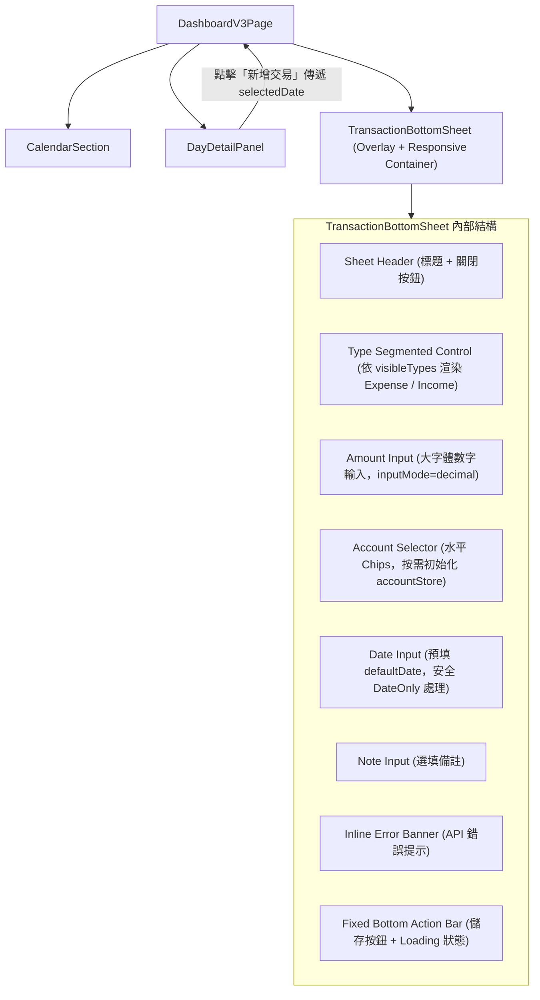
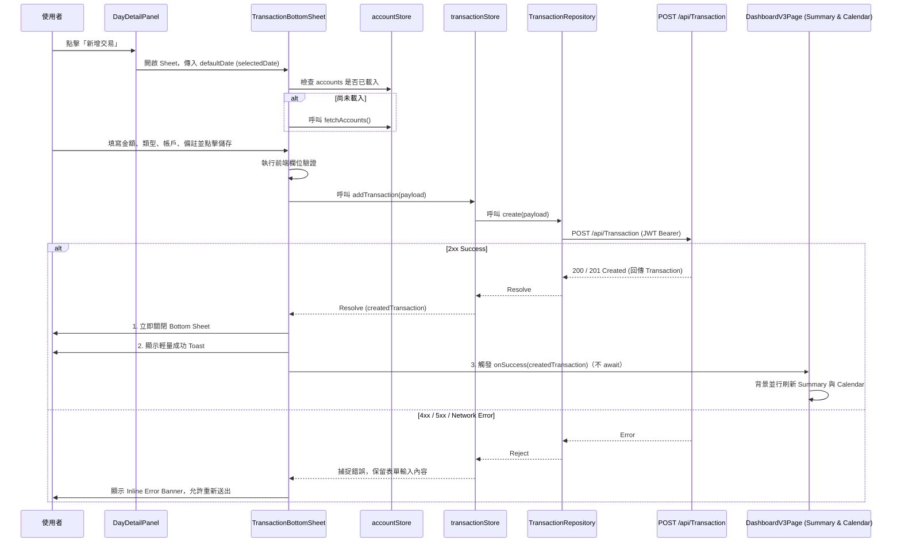

# Transaction Bottom Sheet Implementation Specification

> **Document Path**: `docs/TransactionBottomSheetImplementationSpec.md`
>
> **Version**: 1.1 (Architecture Review Revised)
>
> **Status**: Phase 1 MVP — Expense & Income Only
>
> **Scope**: 取代 `DayDetailPanel` 現有的 Preview Modal，以手機優先的 Bottom Sheet 實作新增交易流程，並與既有 Dashboard V3 資料流整合。

### MVP 邊界（Out of Scope）
本階段**不包含**以下項目：
* `Transfer`（轉帳）UI 操作與雙帳戶選擇（但底層保留完整 `TransactionType` Enum）
* `Category`（分類）UI 與強制驗證（但 Payload 保留擴充欄位）
* 手勢拖曳關閉（Drag Gesture / Swipe Dismiss）
* Legacy `TransactionPage` 移除
* 全域右下角懸浮按鈕（FAB）

---

## 1. Component Architecture

`TransactionBottomSheet` 掛載於 `DashboardV3Page` 層級，由 `DayDetailPanel` 觸發開啟並帶入當前選取日期。裝置適配採「手機端 Bottom Sheet、桌面端置中 Modal」，MVP 階段僅實作 **open/close、overlay、responsive**，**不實作手勢拖曳與下拉關閉**。

---

## 2. Data Flow

完全複用既有 Store 與 Repository，不新增新的 Backend Endpoint。核心事件為 **Transaction Created**，Dashboard 刷新屬於外部 UI Side Effect，**Sheet 不等待父層刷新完成**。

---

## 3. Props Interface

`TransactionBottomSheet` 僅定義受控屬性與非阻斷事件回呼，將「交易建立成功」與「儀表板刷新」徹底解耦：

| Prop Name | Type | Required | Description |
| :--- | :--- | :---: | :--- |
| `isOpen` | `boolean` | 是 | 控制 Bottom Sheet 開啟與關閉。 |
| `defaultDate` | `string` (`YYYY-MM-DD`) | 是 | 預填的交易日期，由 `DayDetailPanel` 當前選取的 `selectedDate` 傳入。 |
| `onClose` | `() => void` | 是 | 點擊遮罩、關閉按鈕或送出成功後觸發的關閉回呼。 |
| `onSuccess` | `(transaction: Transaction) => void` | 否 | **Transaction Created** 事件回呼（同步觸發、不回傳 Promise）。由父層 `DashboardV3Page` 自行決定觸發哪些背景刷新，Sheet 不等待刷新結果。 |

---

## 4. State Management

嚴格區分「表單局部狀態」與「既有全域狀態」，並明確處理 `accountStore` 延遲初始化風險：

### Local Form State（存在於 `TransactionBottomSheet` 內部）
* `transactionType`：**保留完整 Domain `TransactionType` 型別**（對應 Backend `1 Expense`、`2 Income`、`3 Transfer`），禁止窄化為 `"expense" | "income"`。
  * UI 層透過常數陣列 `visibleTypes = [TransactionType.Expense, TransactionType.Income]` 控制 Phase 1 顯示選項，預設選取 `TransactionType.Expense`。
* `amount`：字串型別儲存輸入值（避免浮點數輸入跳動），送出時轉為數值。
* `accountId`：當 `accountStore.accounts` 可用時，預設選取第一個有效帳戶。
* `transactionDate`：每次 `isOpen` 由 `false` 轉為 `true` 時，同步重設為 `defaultDate`。
* `note`：預設為空字串 `""`。
* `fieldErrors`：各欄位的前端驗證錯誤訊息。
* `isSubmitting`：送出期間鎖定表單，防止重複送出。
* `submitError`：API 請求失敗時的錯誤訊息（重新編輯或再次送出時清除）。

### External / Global State（既有模組與初始化策略）
* **`accountStore`（按需初始化防呆）**：
  * 由於 Dashboard V3 首頁僅呼叫 Summary API 與 Calendar API，**不可假設 `accountStore` 已經有資料**。
  * 當 `TransactionBottomSheet` 開啟（`isOpen === true`）時，必須檢查 `accountStore.accounts`：
    * **已有資料** → 直接渲染帳戶 Chips。
    * **尚未載入 / 為空** → 立即呼叫 `accountStore.fetchAccounts()`，載入期間於帳戶選擇區顯示局部 Skeleton，載入失敗則提供局部重試。
* **`transactionStore`**：呼叫 `addTransaction()` 執行建立流程。
* **`useDashboardData` & `useDashboardCalendar`**：僅由父層 `DashboardV3Page` 於 `onSuccess` 中觸發刷新，Sheet 本身不直接依賴這兩個 Hook。

---

## 5. Validation Rules & Payload Extensibility

Phase 1 MVP 採「輕量防呆、不破壞長期契約」原則：

| 欄位 | 必填 | 驗證規則與契約策略 | 錯誤提示行為 |
| :--- | :---: | :--- | :--- |
| **`transactionType`** | 是 | 使用完整 `TransactionType` Enum（`1 Expense` / `2 Income` / `3 Transfer`）；Phase 1 UI 僅透過 `visibleTypes` 暴露 `Expense` 與 `Income`。 | 透過 Segmented Control 鎖定合法值。 |
| **`amount`** | 是 | 必須為有效數字且 **大於 0**（不可為 `0`、負數、空白或 `NaN`）。 | 輸入框下方顯示行內錯誤提示，焦點移至金額欄位。 |
| **`accountId`** | 是 | 必須選取一個存在於 `accountStore` 的有效帳戶 ID。 | 若 `fetchAccounts()` 完成後仍無任何帳戶，顯示提示並禁用送出按鈕。 |
| **`transactionDate`** | 是 | 必須為合法 `YYYY-MM-DD` 格式字串（禁止使用 `new Date("YYYY-MM-DD")` 解析）。 | 格式異常時提示選擇有效日期。 |
| **`note`** | 否 | 選填；送出前執行前後去空白（`trim`），若為空字串則依既有 `POST /api/Transaction` 契約傳送 `null` 或 `""`。 | 不阻擋送出。 |
| **`categoryId`** | 否 | **Phase 1 不顯示 Category UI，也不做強制驗證**；但前端送出的 Transaction Payload 型別必須**保留可選的 `categoryId` 擴充欄位**（不寫死、不鎖死 API Contract），確保未來接入 Budget Radar 與分類選擇器時無需破壞性重構。 | 不阻擋送出。 |

---

## 6. Success Refresh Flow

遵循 **「先完成記帳回饋，再非同步刷新儀表板」** 的順序，確保操作體感極快：

1. **POST 成功**：`POST /api/Transaction` 回傳 2xx，取得新建的 `Transaction` 資料。
2. **立即關閉 Sheet**：呼叫 `onClose()` 關閉表單並重置表單狀態（不等待儀表板刷新）。
3. **顯示輕量 Toast**：顯示非阻斷式回饋（例如「已新增支出 -$150」），絕不使用阻斷式 Alert Modal。
4. **觸發背景刷新（UI Side Effect）**：呼叫 `onSuccess?.(createdTransaction)`，由 `DashboardV3Page` 在背景並行觸發：
   * `useDashboardData` 刷新 `GET /api/dashboard/v3/summary`（更新 `HeroStats`、`AccountSummaryWidget`、`RecentTransactionsWidget`）。
   * `useDashboardCalendar` 刷新當月標記與當前 `selectedDate` 單日明細（更新 `CalendarSection` 與 `DayDetailPanel`）。
5. **跨日情境處理**：若使用者手動將日期改為非當前 `DayDetailPanel` 選取的日期，背景仍照常刷新 Summary 與當前月曆檢視，不強制跳轉使用者目前的日曆焦點。

---

## 7. Error Handling

| 錯誤情境 | 系統行為與 UI 處理 |
| :--- | :--- |
| **前端驗證失敗** | 阻擋 API 呼叫，於對應欄位下方顯示行內錯誤訊息。 |
| **`accountStore.fetchAccounts()` 失敗** | 帳戶選擇區顯示載入失敗訊息與局部重試按鈕，禁用儲存按鈕。 |
| **無可用帳戶（`accounts` 為空）** | 帳戶選擇區顯示空狀態提示（「請先建立至少一個帳戶」），禁用儲存按鈕。 |
| **API `400 Bad Request`** | 解析後端 `ProblemDetails` 訊息並顯示於表單內 `Inline Error Banner`；**保留使用者已填寫的所有欄位內容**。 |
| **API `401 Unauthorized`** | 關閉表單並交由全域 Auth 攔截機制導向登入頁。 |
| **API `500` / Network / Timeout** | 顯示友善錯誤訊息，解除 `isSubmitting` 鎖定，保留輸入內容供使用者直接重試。 |
| **重複點擊防護** | `isSubmitting === true` 期間禁用儲存按鈕、遮罩點擊關閉與 ESC 關閉，防止重複送出。 |

---

## 8. Implementation Tasks

建議 Copilot 依以下順序逐步實作，每步完成皆確認 TypeScript 編譯無誤：

* **Task 1：建立 `TransactionBottomSheet` 基礎容器**
  * 實作基本容器能力：**`open/close`、`overlay`（點擊遮罩關閉）、`responsive`（手機端 Bottom Sheet / 桌面端置中 Modal）**。
  * **明確排除**：不實作手勢拖曳（drag gesture）與下拉關閉（swipe dismiss），避免過度複雜化 MVP。
* **Task 2：實作 Expense / Income MVP 表單 UI 與 `accountStore` 按需初始化**
  * 保留完整 `TransactionType` Enum，以 `visibleTypes = [Expense, Income]` 渲染類型切換。
  * 實作大字體金額輸入框、日期輸入（預填 `defaultDate`）、備註欄（不渲染 Category UI，但 Payload 保留 `categoryId` 擴充性）。
  * 開啟時檢查 `accountStore.accounts`，若未載入則自動觸發 `fetchAccounts()` 並處理 Loading / Empty / Error 狀態。
* **Task 3：串接驗證與 `transactionStore.addTransaction()`**
  * 實作 Section 5 驗證規則、`isSubmitting` 防重送鎖定與 Section 7 錯誤處理（保留表單輸入）。
  * 送出成功後嚴格依序執行：`close sheet → toast → onSuccess?.(transaction)`（不 await 父層刷新）。
* **Task 4：替換 `DayDetailPanel` 入口並接通背景刷新**
  * 移除 `DayDetailPanel` 原本的 Preview Modal，改為開啟 `TransactionBottomSheet` 並傳入 `selectedDate`。
  * 於 `DashboardV3Page` 接收 `onSuccess`，背景觸發 `useDashboardData` 與 `useDashboardCalendar` 刷新。
* **Task 5：補齊 i18n 五語系鍵值**
  * 於 `zh-TW`、`en`、`pt-BR`、`ko`、`ja` 補齊表單標題、欄位標籤、帳戶載入失敗提示、驗證錯誤訊息與成功 Toast 文案。
* **Task 6：Build 與測試驗證**
  * 執行 `npm run build` 與 `npm test` 確認零錯誤。
  * 手動驗證：`accountStore` 尚未載入時開啟 Sheet 會自動抓取帳戶；送出成功後立即關閉並顯示 Toast，隨後背景刷新 `HeroStats` / `AccountSummaryWidget` / `DayDetailPanel`；API 失敗時表單內容保留。